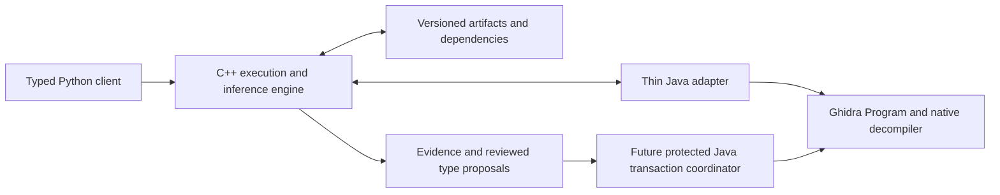

# Architecture and implementation gates

BinaryRat is a C++20 engine integrated with a Ghidra 12.2 fork. Ghidra continues
to own disassembly, native decompilation, SLEIGH semantics, and Program persistence.
Java remains a thin adapter where the framework requires it; Python exposes
typed scripting. No replacement disassembler or decompiler is planned.

The current bridge exports immutable snapshots to the native consumer. A future
bidirectional adapter will keep a JVM/program session alive and submit approved
mutations through a single coordinator. The current native process must not be
described as implementing that JVM daemon.

## Ordered gates

1. **Baseline:** official release identity, reproducible native and Ghidra builds,
   Linux/Windows CI, separated debug oracles, exact-output harness. Implemented
   foundations require CI evidence for each platform before platform certification.
2. **Execution:** bound workers and memory; prove coherent reads, cancellation,
   exact stock parity; attach conservative cache invalidation before reuse.
3. **Scripting:** embedded/remote parity, resource ownership, stable versioned
   DTOs, type stubs, notebook and REPL examples; then a persistent JVM session.
4. **Types:** p-code facts and call-site summaries, recursive SCC fixed points,
   subtype bounds and per-call instantiation; then aggregate layout and ABI-specific
   MSVC/Itanium collectors. Existing RTTI recovery is a baseline.
5. **Safe application:** review by default; never modify user/imported type
   definitions; compare expected old state inside a transaction. Persist before/
   after records and definitions for compensating undo after restart. User edits
   become protected. Reject conflicting reversal rather than overwrite them.
6. **Scale:** profile stock analyzers, replace only eligible passes preserving
   priorities, compare canonical Program state, and demonstrate improvement on
   meaningful 100 MB+ kernel/browser-family inputs.

No feature is complete solely because an implementation exists. Automated tests,
accuracy or compatibility checks, and benchmark evidence are required.

## State and cache correctness

Decompiler output depends on body bytes, context, symbols, types, callee signatures,
memory, overrides, compiler specifications, injections, options and tool versions.
`DomainObject.getModificationNumber()` is a runtime guard, not a durable content
fingerprint. Begin with conservative invalidation. Precise dependency reuse must
pass mutation tests against fresh stock recomputation. Delayed/unclassified events
cause broad invalidation. Native decompiler state also needs lifecycle management.

`DecompInterface`, `DecompilerCallback`, `AutoAnalysisManager`, `AnalysisWorker`,
`Program`, `HighFunction`, `PcodeOp`, `Varnode`, `DataTypeManager`, and
`HighFunctionDBUtil` are existing upstream components. Transactions provide undo,
not independent worker isolation. Do not parallelize arbitrary stock analyzers.
The existing script transaction means a postScript cannot simply acquire a
Program modification lock; current execution requires exclusive headless ownership
and checks modification guards. Snapshot support and complete callback-read
observation are **VERIFY IN SOURCE** before selecting future seams. Look in
`DomainObjectAdapterDB`, `ProgramDB`, `DecompileCallback`, and `DecompInterface`.

## Evaluation contract

GCC/Clang use O0–O3. MSVC uses /Od,/O1,/O2,/Ox without false level equivalence.
Keep DWARF/PDB separate and disable discovery during inference. Compare recursive
structural facts, field offsets/widths, pointer/signature assertions and class
relationships by compiler, ISA, ABI and optimization. Publish precision, recall,
coverage, confidence calibration, observable denominators and exclusions. Split
calibration/evaluation by program family. Optimized-away source facts can be
unrecoverable; do not fabricate names, union semantics or array bounds.

Exact decompiler comparisons use identical frozen state and options with type
application disabled. After a type change, compare against fresh stock output of
that changed state. Benchmarks include stock serial AND stock parallel facilities,
paired repeated runs, cold/warm conditions, aggregate JVM/native memory, and
separate decompilation versus total analysis time. Tiny-fixture timing establishes
integration, not scalability. Full large-binary accuracy/performance gates remain open.

Prior work: [Retypd](https://arxiv.org/abs/1603.05495),
[TIE](https://users.ece.cmu.edu/~aavgerin/papers/tie-ndss-2011.pdf), and
[OOAnalyzer](https://edmcman.github.io/papers/ccs18.pdf). Review implementation
licenses separately before adopting third-party code.
