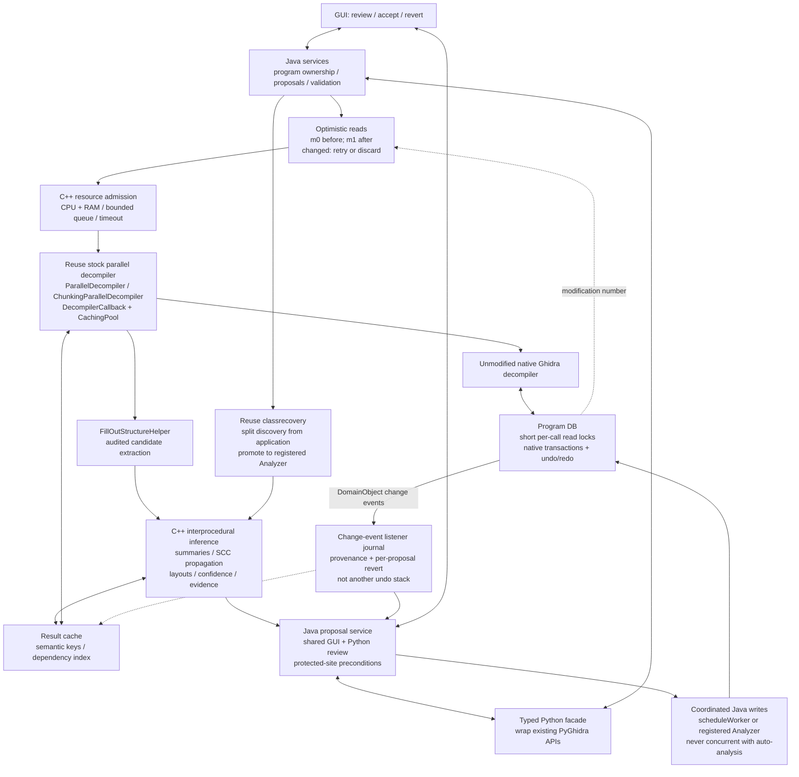
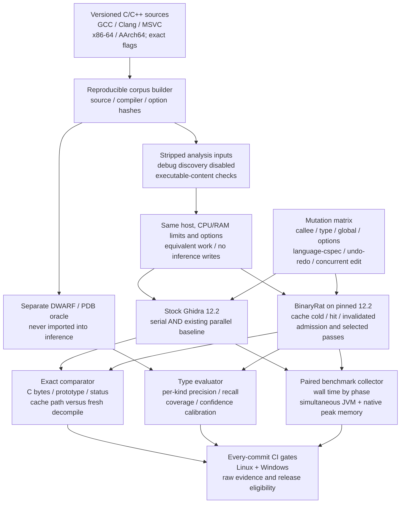

# Architecture and implementation gates

BinaryRat's new execution, cache and inference engine is C++20. Ghidra retains
its Java framework, SLEIGH semantics, native decompiler and Program database.
Java services mediate Program operations; Python supplies a typed facade. This
revised design uses the pinned [Ghidra_12.2_build source](https://github.com/NationalSecurityAgency/ghidra/tree/Ghidra_12.2_build).
BinaryRat component labels below describe proposed services, not existing APIs.

## Corrected architecture



The Program DB provides no snapshot reads for this design. Ordinary calls take
short read locks; immutable exported DTOs are results of an optimistic attempt,
not database snapshots. No correctness claim depends on a stable read epoch.

**Current implementation versus target:** [Gate status](#gate-status) lists what
exists for each gate and what remains; [Roadmap](#roadmap) gives the order of the
remaining work.

## Reuse the existing implementations

| Existing Ghidra 12.2 capability | BinaryRat adds |
|---|---|
| `ParallelDecompiler`, `ChunkingParallelDecompiler`, `DecompilerCallback` and `CachingPool<DecompInterface>` | Result caching, resource admission, dependency invalidation and measured still-serial analyzer work |
| `DecompilerSwitchAnalyzer`, `DecompilerCallConventionAnalyzer`, `CppExporter` already using parallel facilities | Baseline their actual behavior; do not claim to introduce their parallelism |
| `FillOutStructureHelper` / `FillOutStructureCmd` | Whole-program summaries, recursive SCC propagation, competing layouts, confidence and evidence |
| `RecoverClassesFromRTTIScript` and `classrecovery` | Promote audited recovery to registered analysis and reviewable proposals with confidence and native undo |
| PyGhidra `open_project`, `program_context`, `transaction`, `analyze`, `walk_programs` | Pythonic objects, bulk access, typed/versioned facade and persistent-session transport |
| BSim, including 12.2's structure reconstruction from a matched program | Signature libraries scored against corpus ground truth; matched structures as one more evidence source |
| Version Tracking correlators | Patch diffs of stock-verified decompilations, with each match's correlator and score |
| P-code emulator | Emulator-checked layouts and decoded strings, with the trace as evidence |

`FillOutStructureHelper` already follows some direct calls when supplied a
`DecompInterface`, with `maxCallDepth = 1` and zero-offset pointer arguments.
BinaryRat extends this bounded traversal with persistent call-site summaries,
polymorphic instantiation and call-graph SCC fixed points.

These utilities are not universally read-only. The helper can extend existing
structures or create a class namespace and move a function. Audit its
new-structure/no-class candidate path and detach mutable candidates; each worker
owns its helper. `FillOutStructureCmd` adds datatypes and updates variables using
`SourceType.USER_DEFINED`. Never execute that command in the read/compute pool.

The RTTI script and Windows/GCC recoverers also clear/create listing data, labels,
namespaces and class structures. Promotion requires a discovery/application
split, not invoking the entire script as a read-only collector. A registered
analyzer discovers evidence and produces proposals; approved application uses
the same protected Java service. Preserve stock analysis priorities, and
parallelize only measured passes that remain serial and have suitable semantics.

## Optimistic reads and coordinated writes

For extraction, decompilation, dependency reads and cache lookup validation:

1. Record `m0 = program.getModificationNumber()` before Program reads.
2. Read inputs and produce immutable results and dependency fingerprints.
3. Record `m1` after the entire attempt, including cache validation.
4. If `m0 != m1`, discard and retry with a fresh decompiler view under bounded
   retry/backoff, or return an explicit stale/cancelled result.
5. Publish with the observed modification number. Revalidate expected old values
   and dependencies inside any later coordinated write. An earlier successful
   check does not prevent later edits or establish isolation.

`DomainObject.getModificationNumber()` increments for changes, undo and redo.
It is a runtime guard, not a durable content fingerprint, and is not included
unconditionally in every persistent cache key. Events can be delayed/coalesced:
use them for invalidation, never as a replacement for before/after validation.

All Program writes go through `AutoAnalysisManager.scheduleWorker(...)` or run
as registered analyzers. Never write in parallel with auto-analysis. Default
`analyzeChanges=true` to preserve follow-on analysis. `scheduleWorker` already
uses a managed transaction, so do not wrap parallel computation in another long
transaction. Its headless path calls the worker immediately: the Java service
must serialize ownership and ensure auto-analysis is not concurrently running.

The C++ solver returns proposals and never holds live Java DB objects. Both GUI
and Python review/accept proposals through the Java service. The facade reuses
PyGhidra's `transaction` wrapper inside the Java-coordinated worker/analyzer;
it does not grant an independent writer access parallel to auto-analysis.
Protect user/imported types and user-edited sites,
validate every affected signature slot, and compare expected old state during
application. Audit `HighFunctionDBUtil`'s whole mutation footprint because a
variable operation may update other parameters.

## Native undo and provenance

Ghidra transactions and native undo/redo remain the source of truth. A
`DomainObjectListener` observes changes and restoration after undo/redo, then
reconciles provenance, proposal state, ownership and cache dirtiness with the DB.
The journal does not implement an independent global undo stack or claim to
extend Ghidra's native undo history across restarts.

Per-proposal revert is an ordinary new coordinated transaction using recorded
application facts. Apply an inverse only if current values still match the
proposal's applied values and protection rules allow it. Preserve/report later
user conflicts. Undo/redo of that reversal remains Ghidra's responsibility.

## Cache key and dependency equivalence

For deterministic canonical serialization `C`:

```text
K = SHA256(C({
  artifact_schema, BinaryRat_algorithm_version,
  Ghidra_commit, native_decompiler_binary_digest,
  program_identity, entry_address_space, entry_offset,
  ordered_body_ranges_and_bytes_digest, instruction_context_digest,
  language_id_and_language_resource_digest,
  compiler_spec_id_and_cspec_resource_digest,
  pcode_injection_and_override_digest,
  effective_decompiler_options_and_simplification_style,
  callee_signature_dependency_digest,
  datatype_dependency_digest,
  global_memory_and_symbol_dependency_digest,
  reference_flow_and_render_override_dependency_digest
}))
```

This is the target artifact-key schema. The experimental native protocol-v1
key currently requires a process-local `revision` and caller-supplied options
digest and has no automatic live Program invalidation. That incomplete shape
must be replaced/versioned before advertising the target cache guarantees.

Dependency contents are explicit:

- **Callees:** target/thunk identity, return/parameter type graphs, parameter
  order/storage, calling convention, varargs, no-return, inline behavior and overrides;
  include bytes/context for any inlined callee bodies the decompiler consumes;
  include indirect-target alternatives and unresolved-target state.
- **Datatypes:** complete reachable definitions, size/alignment, field offsets,
  packing, bitfield storage/offset/width, union alternatives,
  pointer/array/typedef relationships and printed names.
  Serialize recursive graphs deterministically.
- **Globals/symbols/render state:** addresses, names/namespaces, declared types,
  relevant memory contents/mappings/permissions, jump/vtable data, comments or
  local/render overrides that affect emitted C. Include absent-memory and failed
  lookup dependencies: a newly introduced definition can change output.
- **Options/language/cspec:** effective options, simplification/output settings,
  language/compiler-spec identities, SLEIGH/resource digests, processor context,
  p-code injections and user overrides, not just default option values.

Store the dependency manifest with the result. Reverse indexes connect changed
functions, types, symbols and ranges to cached artifacts and call/SCC summaries.
If a dependency class or query footprint is incomplete, use a conservative global
semantic digest for it and broad invalidation. Unknown events, restoration,
missing coverage and uncertain indirect reads take this conservative path. A
call graph or `HighFunction` alone is not a complete native read footprint.
Callback-read interception is extension-only: `DecompileCallback` and its query
methods are public and not final, `DecompInterface.decompCallback` and
`initializeProcess()` are protected, and `DecompileProcess` routes every native
query through those methods, so `TracingDecompiler` installs a recording subclass
without a core patch.

Cache successful complete decompilations only as successes; retain timeout,
crash, cancellation and stale status explicitly. Do not persist live `Function`
or `HighFunction` objects. Ghidra 12.2 already flushes native cache state at the
end of normal `DecompInterface.decompileFunction`; preserve it, and reset wider
native views when required instead of adding duplicate unconditional flushes.

**Required cache-versus-fresh test:** cache output, change one dependency through
a coordinated write, request the cache path and compare its C bytes, prototype
and status against a fresh stock decompile of the same resulting state. Cover
callee signatures, datatype layouts/names, global data, symbols/render overrides,
options, language/cspec/context, undo and redo. Mutate an unrelated dependency
and require reuse only when the tracked footprint proves it is unrelated.
Inject a change during extraction and require retry/discard. On reopen, validate
dependency content again; equal process-local modification numbers are not proof.

## CPU and RAM admission

Reuse Ghidra's parallel machinery under a BinaryRat admission gate:

```text
workers <= min(CPU_budget, worker_cap,
               floor((RAM_budget - JVM_reserve - other_analysis_reserve)
                     / reserved_native_worker_bytes))
```

Reserve per-function memory using measured worker RSS and function-size/complexity
estimates, and lower concurrency under pressure. If no worker fits, queue or
return resource exhaustion; do not force one over budget. Bound pending tasks
and result bytes too. Acquire admission before borrowing `DecompInterface`,
allow one active request per lease, and account for other analysis pools.

Each function has a timeout and cancellation monitor. Release/recycle failed
workers and drain safely. Test CPU limits, RAM exhaustion, large-function
concurrency reduction, bounded backpressure, timeout status and crash cleanup.
A shared-pool thread-count setting alone is insufficient.

## Stock 12.2 versus BinaryRat harness



GCC/Clang use O0-O3. MSVC uses /Od,/O1,/O2,/Ox without claiming equivalence.
Compare structural type facts by storage/live ranges, layout and inline context;
publish observable denominators, exclusions and per-kind results by compiler,
ISA, ABI and optimization. Split calibration/evaluation by project family.
Existing structure/class recovery is also an accuracy baseline. Ground truth
never enters the inference Program.

The raw comparator keeps the official ascending, reused-process stock
reference. Ghidra's join-space allocations can survive its native flush and
affect both analysis and printed temporary names. Program dependency replay
does not capture this process history. The `stock-verified` export runs the
scheduled phase first, then checks each record with an independent ascending
serial pass. It writes a match count, fallback count, and digest of the exported
bytes. The large-file CI test compares that export to a separate stock JVM.
[LLVM parity evidence](evidence/llvm19-linux.md)
The source-built fork drops those join records at each native flush, so it
prints every function as a new official decompiler process does, in any order.
[Core patch](core-patches/decompiler-join-flush.md)

Use identical binaries, CPU/RAM budgets, JVM heap, options and timeouts for
paired repeated trials. Measure cold and warm caches separately. Separate import,
auto-analysis, decompilation, inference and write-back/follow-on analysis: faster
decompilation alone does not prove faster auto-analysis. Peak memory includes JVM
and native descendants at the same instant, with sampling gaps explicit. After
types change, compare with fresh stock output of that changed state. Meaningful
100 MB+ kernel/browser-family inputs and repeated statistical measurements are
required before claiming speedup.

## Ordered gates

1. **Baseline:** pinned toolchain, Linux/Windows builds, separated oracles and
   exact-output harness.
2. **Execution:** stock parallel reuse, optimistic validation, CPU/RAM admission,
   timeouts, conservative cache correctness and cache-versus-fresh tests.
3. **Services/scripting:** Java proposal hub, PyGhidra facade, typed/versioned DTOs,
   notebooks/REPL and persistent JVM ownership.
4. **Types:** extend helper evidence using summaries/SCCs; promote audited RTTI
   recovery; score every assertion/edge and calibrate on held-out projects.
5. **Application:** protected Java writes, native undo/redo, event-driven
   provenance and conflict-aware per-proposal revert.
6. **Scale:** accelerate measured still-serial analyzers, preserve priorities,
   compare canonical Program state and pass large-binary benchmarks.

No feature is complete solely because code exists. Automated compatibility or
accuracy checks and benchmark evidence are required. Small-fixture tests do not
complete interprocedural recovery, calibrated confidence, native undo integration,
RAM admission or large-binary performance gates.

## Gate status

Status in November 2026. Done means automated checks or recorded evidence exist.
[Verification](VERIFICATION.md)

| Gate | Done | Open |
|---|---|---|
| 1. Baseline | Hash-pinned Ghidra 12.2 and Temurin JDK; fork source builds on Linux and Windows for every commit; GCC, Clang, AArch64 and MSVC x64/ARM64 corpora with separate DWARF/PDB oracles; byte-exact comparator; whole-program profiler; twelve calibration families built from hash-pinned sources | More families, compilers and targets; external benchmarks (milestone 1) |
| 2. Execution | Leases with CPU/RAM admission, deadlines, cancels and resident-memory limits on real decompilations; live cache with replay; `cache-proof` rounds, cold/warm and reopen checks; stock-verified export | Per-function memory estimates; `cache-proof` rounds for options and language/cspec; an injected mid-extraction change |
| 3. Services/scripting | `SummaryLayouts`, `CallSites` and `StackStrings` Java services shared by scripts, PyGhidra and the live service; the `DecompilationSession` scheduling service; typed, versioned DTOs; a read-only JVM shared by local clients; analyst commands | One proposal service for GUI and Python review; an agent interface (milestone 2); writable JVM ownership |
| 4. Types | P-code layout evidence with bounded direct-call forwarding and union views; SCC summary solver with CodeBrowser access and call-path evidence; Itanium and MSVC RTTI evidence; a program-wide layout survey; field scores fitted on six source families and checked on six others | Flows through memory and indirect calls; calibration of evidence carried from callees; fitted estimates in reports; a registered RTTI analyzer |
| 5. Application | Reviewed creation of a new structure, retyping an eligible generic-pointer parameter from live summary evidence, and a reviewed call-site prototype override with native undo | Reviewed type application to additional targets; shared provenance journal; per-proposal revert |
| 6. Scale | No-return analyzer core patch, faster on a focused fixture; join-flush core patch; 384-function LLVM parity | A completed whole-program run on a code-heavy 100 MB+ input (the LLVM run reached its deadline); speedup evidence |

## Roadmap

The milestones run in this order and close like the gates: with automated checks
or recorded evidence. Measurement comes first because calibration, type
benchmarks and speed claims all depend on it. Speed work stays after types and
application: no whole-program speed claim is possible until a code-heavy run
completes. The research listed at the end shows larger gaps in correctness and
trust: refined output that recompiles but behaves differently, and accuracy
figures that rely on functions seen in training.

### 1. Measure (gate 1)

Done: field scores are fitted on six source families and checked on six
others, with functions deduplicated by hash before the split, each access
counted for one proposal, and reliability error, precision and recall reported
on the held-out families.
[Calibration evidence](evidence/confidence-calibration.md)

- Grow the corpus to at least eight held-out families, the minimum for
  intervals, and add Clang, other optimization levels, AArch64 and MSVC builds
  (for example Assemblage builds).
- Measure evidence carried from callees, still counting each origin once: a
  propagated summary and the access it came from are not independent support.
- Print the fitted estimate beside the support score once the wider corpus
  confirms it.
- DecompileBench as a baseline. Stock-verified output equals stock Ghidra, so the
  scores equal Ghidra's until applied types change the output. The benchmark
  measures milestone 4, not the export path.
- Report behavioural divergence of recompiled output from the original binary,
  not recompile rates alone: LLM refinement raises recompile rates while
  behaviour drifts.
- Score call-site and indirect-call evidence on ICALL-BENCH, whose ground truth
  comes from dynamic profiling.
- Nightly whole-program profiles of the LLVM library and Godot.

### 2. Agent interface (gate 3)

- Build a read-only MCP server over the existing `binaryrat-live` service and
  typed Python API. The loopback client now exposes bounded stack-string
  evidence for a saved Program.
- Binary-derived text (strings, names, comments) is returned as data with its
  address, never as instructions.
- Selective retrieval: what changed since the agent's last visit, answered from
  the dependency-tracked cache.
- A provenance manifest on every export and report (Ghidra build, analyzer
  options, input hash), and SARIF output for evidence.
- Writes come later, only through the milestone 4 review service.

### 3. Types (gate 4)

- Pointers passed through memory and indirect calls, with a subtyping solver in
  the style of BinSub.
- Summary-solver results in the CodeBrowser evidence table and in reviewed
  structure creation.
- More evidence sources: Ghidra 12.2's BSim structure reconstruction from a
  matched program, and layout hypotheses checked on the p-code emulator, with
  the trace as evidence.
- Promote RTTI evidence to a registered analyzer.
- Benchmark against TRex and stock structure recovery on the milestone 1 families.

### 4. Application (gate 5)

- Apply reviewed types to existing parameters, variables and fields through one
  review service for CodeBrowser, Python and agents.
- Show the affected target, current type and evidence before approval. Navigate
  to the address-space-qualified instruction after checking the Program revision. Keep a
  call-site correction scoped to its caller and instruction. A callee signature
  change requires its own proposal and review. Hex-Rays exposes these as
  distinct actions. [Hex-Rays Set Call Type](https://docs.hex-rays.com/9.0/user-guide/decompiler/interactive/cmd_set_call_type) · [Synchronized views](https://docs.hex-rays.com/ida-9.2/user-guide/user-interface/subviews#synchronized-views)
- Event-driven provenance journal and conflict-aware per-proposal revert.
- After each applied change, compare with a fresh stock decompilation of the
  changed Program and rerun the milestone 1 benchmarks.

### 5. Scale (gate 6)

- Finish the no-return candidate on whole programs. Profile the Call-Fixup
  Installer, and instruction decoding apart from `CodeManager.addInstructions`.
- Measure time to the first useful result, p95 selected-function latency under
  background analysis, and cancellation latency on the same fixtures. Include
  options actually applied, unavailable analyzers and completion status in a
  machine-readable profile record. Binary Ninja documents which analyses its
  modes defer and prioritizes user-directed analysis. [Binary Ninja analysis workflow](https://docs.binary.ninja/guide/index.html#analysis) · [Analysis settings](https://docs.binary.ninja/guide/settings.html)
- Per-function memory estimates for admission.
- A completed stock-versus-BinaryRat whole-program run on a code-heavy 100 MB+
  input, with repeated measurements, before any speedup claim.

### 6. Analyst features (new scope)

Each feature proposes facts with evidence and leaves stock output unchanged
unless an analyst applies a change through review.

- Version comparison starts with read-only function matches. Show each binary
  hash and function address, the correlator, its score and competing matches
  alongside the stock-verified decompilation diff. Keep scores comparable within
  each correlator. Require analyst confirmation for ambiguous matches and
  separate approval for any annotation transfer. Test duplicates, moved
  functions and destination Programs with existing analyst annotations.
  [Ghidra Version Tracking matches](https://github.com/NationalSecurityAgency/ghidra/blob/Ghidra_12.2_build/Ghidra/Features/VersionTracking/src/main/help/help/topics/VersionTrackingPlugin/providers/VT_Matches_Table.html) · [BinDiff matched functions](https://www.zynamics.com/bindiff/manual/#sectMatchedFunctions)
- Signature libraries built from the corpus (libc, zlib, OpenSSL, Rust std) with
  measured precision and recall; WARP import and export; a shared BSim database.
- Mixed boolean-arithmetic simplification over p-code with an equivalence proof
  attached to every rewrite, shown beside the stock output. Review the license
  of CoBRA's C++ library before adopting it.
- Add decoded and loop-built strings from the p-code emulator. Preserve their
  observation trace and report the recovery method alongside constant stack
  writes. FLOSS documents distinct recovery categories for analysts.
  [FLOSS string types](https://github.com/mandiant/flare-floss) · [FLOSS report format](https://github.com/mandiant/flare-floss/blob/master/doc/results_document.md)
- Firmware base-address candidates scored by the pointers they resolve, and SVD
  peripheral import as a reviewed change.
- Rust data-layout evidence. Go needs no BinaryRat pass: Ghidra 12.2 already
  analyzes current Go releases, including Go 1.26.

### Hardening (every milestone)

- Extend the seeded fuzzers to every input BinaryRat parses itself: cache record
  files, exports, and the reports read by the Python tools.
- Treat a shared cache directory as untrusted: authenticate records before replay.
- Import and analyze hostile samples in a resource-capped process without network
  access.
- Ship each upstream security release. Ghidra 12.0.3 fixed command execution from
  annotations in generated comments (CVE-2026-4946); 12.2 fixed path traversal,
  zip-bomb archives and a debugger connector command injection.

### Not planned

- Machine-learned names or types as evidence. Name-recovery models train on
  debug information and cannot be checked against the binary; at most they could
  appear as low-authority suggestions in review.
- Replacing decompiler output with LLM rewrites. Any rewrite would be an overlay
  behind the behavioural check.
- Training binary-similarity models: BSim and WARP cover matching.
- A collaboration server (Ghidra Server is inherited), VM devirtualization, and
  .NET, WebAssembly or Dalvik decompilation.

Research behind this order:
[When LLM decompilers recompile more and preserve less](https://arxiv.org/abs/2609.05370),
[XTRIDE](https://arxiv.org/abs/2603.08225),
[ICALL-BENCH](https://arxiv.org/abs/2610.37871),
[CoBRA](https://blog.trailofbits.com/2026/04/03/simplifying-mba-obfuscation-with-cobra/),
[CVE-2026-4946](https://nvd.nist.gov/vuln/detail/cve-2026-4946), and the Ghidra 12.2
change history (GP-6921, BSim structure reconstruction).

## Pinned source references

- [Parallel package](https://github.com/NationalSecurityAgency/ghidra/tree/Ghidra_12.2_build/Ghidra/Features/Decompiler/src/main/java/ghidra/app/decompiler/parallel),
  [DecompilerSwitchAnalyzer](https://github.com/NationalSecurityAgency/ghidra/blob/Ghidra_12.2_build/Ghidra/Features/Decompiler/src/main/java/ghidra/app/plugin/core/analysis/DecompilerSwitchAnalyzer.java),
  [DecompilerCallConventionAnalyzer](https://github.com/NationalSecurityAgency/ghidra/blob/Ghidra_12.2_build/Ghidra/Features/Decompiler/src/main/java/ghidra/app/plugin/core/analysis/DecompilerCallConventionAnalyzer.java),
  [CppExporter](https://github.com/NationalSecurityAgency/ghidra/blob/Ghidra_12.2_build/Ghidra/Features/Decompiler/src/main/java/ghidra/app/util/exporter/CppExporter.java).
- [FillOutStructureHelper](https://github.com/NationalSecurityAgency/ghidra/blob/Ghidra_12.2_build/Ghidra/Features/Decompiler/src/main/java/ghidra/app/decompiler/util/FillOutStructureHelper.java)
  and [FillOutStructureCmd](https://github.com/NationalSecurityAgency/ghidra/blob/Ghidra_12.2_build/Ghidra/Features/Decompiler/src/main/java/ghidra/app/decompiler/util/FillOutStructureCmd.java).
- [RecoverClassesFromRTTIScript](https://github.com/NationalSecurityAgency/ghidra/blob/Ghidra_12.2_build/Ghidra/Features/Decompiler/ghidra_scripts/RecoverClassesFromRTTIScript.java)
  and [classrecovery](https://github.com/NationalSecurityAgency/ghidra/tree/Ghidra_12.2_build/Ghidra/Features/Decompiler/ghidra_scripts/classrecovery).
- [AutoAnalysisManager](https://github.com/NationalSecurityAgency/ghidra/blob/Ghidra_12.2_build/Ghidra/Features/Base/src/main/java/ghidra/app/plugin/core/analysis/AutoAnalysisManager.java),
  [DomainObject](https://github.com/NationalSecurityAgency/ghidra/blob/Ghidra_12.2_build/Ghidra/Framework/Project/src/main/java/ghidra/framework/model/DomainObject.java),
  [PyGhidra API](https://github.com/NationalSecurityAgency/ghidra/blob/Ghidra_12.2_build/Ghidra/Features/PyGhidra/src/main/py/src/pyghidra/api.py).

Prior work: [Retypd](https://arxiv.org/abs/1603.05495),
[TIE](https://users.ece.cmu.edu/~aavgerin/papers/tie-ndss-2011.pdf), and
[OOAnalyzer](https://edmcman.github.io/papers/ccs18.pdf). Review implementation
licenses separately before adopting code.
