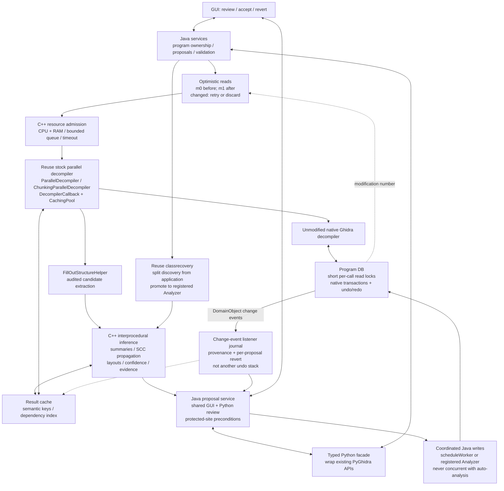
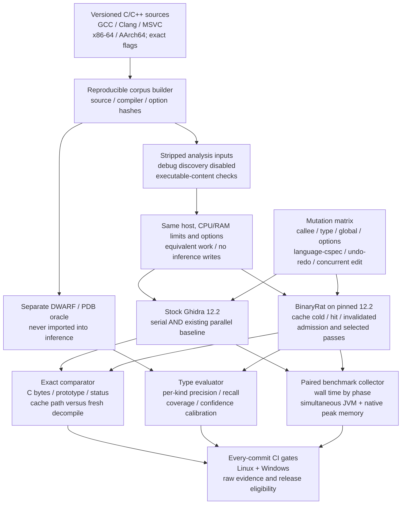

# Architecture and implementation gates

BinaryRat's new execution, cache and inference engine is C++20. Ghidra retains
its Java framework, SLEIGH semantics, native decompiler and Program database.
Java services mediate Program operations; Python supplies a typed facade. This
revised design uses the pinned [Ghidra_12.2_build source](https://github.com/NationalSecurityAgency/ghidra/tree/Ghidra_12.2_build).
BinaryRat component labels below describe proposed services, not existing APIs.

## Corrected architecture



The Program DB provides no snapshot reads for this design. Ordinary calls take
short read locks; immutable exported DTOs are results of an optimistic attempt,
not database snapshots. No correctness claim depends on a stable read epoch.

**Current implementation versus target:** the native artifact server, bounded
executor, preliminary layout-evidence aggregation, typed client and headless
stock-decompiler adapter exist. Shared Java proposal services, automatic live
invalidation, RAM admission, coordinated type application and a persistent
Ghidra/PyGhidra JVM daemon remain implementation gates. A persistent native
process is not a persistent Ghidra JVM.

## Reuse the existing implementations

| Existing Ghidra 12.2 capability | BinaryRat adds |
|---|---|
| `ParallelDecompiler`, `ChunkingParallelDecompiler`, `DecompilerCallback` and `CachingPool<DecompInterface>` | Result caching, resource admission, dependency invalidation and measured still-serial analyzer work |
| `DecompilerSwitchAnalyzer`, `DecompilerCallConventionAnalyzer`, `CppExporter` already using parallel facilities | Baseline their actual behavior; do not claim to introduce their parallelism |
| `FillOutStructureHelper` / `FillOutStructureCmd` | Whole-program summaries, recursive SCC propagation, competing layouts, confidence and evidence |
| `RecoverClassesFromRTTIScript` and `classrecovery` | Promote audited recovery to registered analysis and reviewable proposals with confidence and native undo |
| PyGhidra `open_project`, `program_context`, `transaction`, `analyze`, `walk_programs` | Pythonic objects, bulk access, typed/versioned facade and persistent-session transport |

`FillOutStructureHelper` already follows some direct calls when supplied a
`DecompInterface`, with `maxCallDepth = 1` and zero-offset pointer arguments.
BinaryRat extends this bounded traversal with persistent call-site summaries,
polymorphic instantiation and call-graph SCC fixed points.

These utilities are not universally read-only. The helper can extend existing
structures or create a class namespace and move a function. Audit its
new-structure/no-class candidate path and detach mutable candidates; each worker
owns its helper. `FillOutStructureCmd` adds datatypes and updates variables using
`SourceType.USER_DEFINED`. Never execute that command in the read/compute pool.

The RTTI script and Windows/GCC recoverers also clear/create listing data, labels,
namespaces and class structures. Promotion requires a discovery/application
split, not invoking the entire script as a read-only collector. A registered
analyzer discovers evidence and produces proposals; approved application uses
the same protected Java service. Preserve stock analysis priorities, and
parallelize only measured passes that remain serial and have suitable semantics.

## Optimistic reads and coordinated writes

For extraction, decompilation, dependency reads and cache lookup validation:

1. Record `m0 = program.getModificationNumber()` before Program reads.
2. Read inputs and produce immutable results and dependency fingerprints.
3. Record `m1` after the entire attempt, including cache validation.
4. If `m0 != m1`, discard and retry with a fresh decompiler view under bounded
   retry/backoff, or return an explicit stale/cancelled result.
5. Publish with the observed modification number. Revalidate expected old values
   and dependencies inside any later coordinated write. An earlier successful
   check does not prevent later edits or establish isolation.

`DomainObject.getModificationNumber()` increments for changes, undo and redo.
It is a runtime guard, not a durable content fingerprint, and is not included
unconditionally in every persistent cache key. Events can be delayed/coalesced:
use them for invalidation, never as a replacement for before/after validation.

All Program writes go through `AutoAnalysisManager.scheduleWorker(...)` or run
as registered analyzers. Never write in parallel with auto-analysis. Default
`analyzeChanges=true` to preserve follow-on analysis. `scheduleWorker` already
uses a managed transaction, so do not wrap parallel computation in another long
transaction. Its headless path calls the worker immediately: the Java service
must serialize ownership and ensure auto-analysis is not concurrently running.

The C++ solver returns proposals and never holds live Java DB objects. Both GUI
and Python review/accept proposals through the Java service. The facade reuses
PyGhidra's `transaction` wrapper inside the Java-coordinated worker/analyzer;
it does not grant an independent writer access parallel to auto-analysis.
Protect user/imported types and user-edited sites,
validate every affected signature slot, and compare expected old state during
application. Audit `HighFunctionDBUtil`'s whole mutation footprint because a
variable operation may update other parameters.

## Native undo and provenance

Ghidra transactions and native undo/redo remain the source of truth. A
`DomainObjectListener` observes changes and restoration after undo/redo, then
reconciles provenance, proposal state, ownership and cache dirtiness with the DB.
The journal does not implement an independent global undo stack or claim to
extend Ghidra's native undo history across restarts.

Per-proposal revert is an ordinary new coordinated transaction using recorded
application facts. Apply an inverse only if current values still match the
proposal's applied values and protection rules allow it. Preserve/report later
user conflicts. Undo/redo of that reversal remains Ghidra's responsibility.

## Cache key and dependency equivalence

For deterministic canonical serialization `C`:

```text
K = SHA256(C({
  artifact_schema, BinaryRat_algorithm_version,
  Ghidra_commit, native_decompiler_binary_digest,
  program_identity, entry_address_space, entry_offset,
  ordered_body_ranges_and_bytes_digest, instruction_context_digest,
  language_id_and_language_resource_digest,
  compiler_spec_id_and_cspec_resource_digest,
  pcode_injection_and_override_digest,
  effective_decompiler_options_and_simplification_style,
  callee_signature_dependency_digest,
  datatype_dependency_digest,
  global_memory_and_symbol_dependency_digest,
  reference_flow_and_render_override_dependency_digest
}))
```

This is the target artifact-key schema. The experimental native protocol-v1
key currently requires a process-local `revision` and caller-supplied options
digest and has no automatic live Program invalidation. That incomplete shape
must be replaced/versioned before advertising the target cache guarantees.

Dependency contents are explicit:

- **Callees:** target/thunk identity, return/parameter type graphs, parameter
  order/storage, calling convention, varargs, no-return, inline behavior and overrides;
  include bytes/context for any inlined callee bodies the decompiler consumes;
  include indirect-target alternatives and unresolved-target state.
- **Datatypes:** complete reachable definitions, size/alignment, field offsets,
  packing, bitfield storage/offset/width, union alternatives,
  pointer/array/typedef relationships and printed names.
  Serialize recursive graphs deterministically.
- **Globals/symbols/render state:** addresses, names/namespaces, declared types,
  relevant memory contents/mappings/permissions, jump/vtable data, comments or
  local/render overrides that affect emitted C. Include absent-memory and failed
  lookup dependencies: a newly introduced definition can change output.
- **Options/language/cspec:** effective options, simplification/output settings,
  language/compiler-spec identities, SLEIGH/resource digests, processor context,
  p-code injections and user overrides, not just default option values.

Store the dependency manifest with the result. Reverse indexes connect changed
functions, types, symbols and ranges to cached artifacts and call/SCC summaries.
If a dependency class or query footprint is incomplete, use a conservative global
semantic digest for it and broad invalidation. Unknown events, restoration,
missing coverage and uncertain indirect reads take this conservative path. A
call graph or `HighFunction` alone is not a complete native read footprint.
Complete callback-read interception is **VERIFY IN SOURCE** in
`DecompileCallback` / `DecompInterface` before promising an extension-only seam.

Cache successful complete decompilations only as successes; retain timeout,
crash, cancellation and stale status explicitly. Do not persist live `Function`
or `HighFunction` objects. Ghidra 12.2 already flushes native cache state at the
end of normal `DecompInterface.decompileFunction`; preserve it, and reset wider
native views when required instead of adding duplicate unconditional flushes.

**Required cache-versus-fresh test:** cache output, change one dependency through
a coordinated write, request the cache path and compare its C bytes, prototype
and status against a fresh stock decompile of the same resulting state. Cover
callee signatures, datatype layouts/names, global data, symbols/render overrides,
options, language/cspec/context, undo and redo. Mutate an unrelated dependency
and require reuse only when the tracked footprint proves it is unrelated.
Inject a change during extraction and require retry/discard. On reopen, validate
dependency content again; equal process-local modification numbers are not proof.

## CPU and RAM admission

Reuse Ghidra's parallel machinery under a BinaryRat admission gate:

```text
workers <= min(CPU_budget, worker_cap,
               floor((RAM_budget - JVM_reserve - other_analysis_reserve)
                     / reserved_native_worker_bytes))
```

Reserve per-function memory using measured worker RSS and function-size/complexity
estimates, and lower concurrency under pressure. If no worker fits, queue or
return resource exhaustion; do not force one over budget. Bound pending tasks
and result bytes too. Acquire admission before borrowing `DecompInterface`,
allow one active request per lease, and account for other analysis pools.

Each function has a timeout and cancellation monitor. Release/recycle failed
workers and drain safely. Test CPU limits, RAM exhaustion, large-function
concurrency reduction, bounded backpressure, timeout status and crash cleanup.
A shared-pool thread-count setting alone is insufficient.

## Stock 12.2 versus BinaryRat harness



GCC/Clang use O0-O3. MSVC uses /Od,/O1,/O2,/Ox without claiming equivalence.
Compare structural type facts by storage/live ranges, layout and inline context;
publish observable denominators, exclusions and per-kind results by compiler,
ISA, ABI and optimization. Split calibration/evaluation by project family.
Existing structure/class recovery is also an accuracy baseline. Ground truth
never enters the inference Program.

Use identical binaries, CPU/RAM budgets, JVM heap, options and timeouts for
paired repeated trials. Measure cold and warm caches separately. Separate import,
auto-analysis, decompilation, inference and write-back/follow-on analysis: faster
decompilation alone does not prove faster auto-analysis. Peak memory includes JVM
and native descendants at the same instant, with sampling gaps explicit. After
types change, compare with fresh stock output of that changed state. Meaningful
100 MB+ kernel/browser-family inputs and repeated statistical measurements are
required before claiming speedup.

## Ordered gates

1. **Baseline:** pinned toolchain, Linux/Windows builds, separated oracles and
   exact-output harness.
2. **Execution:** stock parallel reuse, optimistic validation, CPU/RAM admission,
   timeouts, conservative cache correctness and cache-versus-fresh tests.
3. **Services/scripting:** Java proposal hub, PyGhidra facade, typed/versioned DTOs,
   notebooks/REPL and persistent JVM ownership.
4. **Types:** extend helper evidence using summaries/SCCs; promote audited RTTI
   recovery; score every assertion/edge and calibrate on held-out projects.
5. **Application:** protected Java writes, native undo/redo, event-driven
   provenance and conflict-aware per-proposal revert.
6. **Scale:** accelerate measured still-serial analyzers, preserve priorities,
   compare canonical Program state and pass large-binary benchmarks.

No feature is complete solely because code exists. Automated compatibility or
accuracy checks and benchmark evidence are required. Small-fixture tests do not
complete interprocedural recovery, calibrated confidence, native undo integration,
RAM admission or large-binary performance gates.

## Pinned source references

- [Parallel package](https://github.com/NationalSecurityAgency/ghidra/tree/Ghidra_12.2_build/Ghidra/Features/Decompiler/src/main/java/ghidra/app/decompiler/parallel),
  [DecompilerSwitchAnalyzer](https://github.com/NationalSecurityAgency/ghidra/blob/Ghidra_12.2_build/Ghidra/Features/Decompiler/src/main/java/ghidra/app/plugin/core/analysis/DecompilerSwitchAnalyzer.java),
  [DecompilerCallConventionAnalyzer](https://github.com/NationalSecurityAgency/ghidra/blob/Ghidra_12.2_build/Ghidra/Features/Decompiler/src/main/java/ghidra/app/plugin/core/analysis/DecompilerCallConventionAnalyzer.java),
  [CppExporter](https://github.com/NationalSecurityAgency/ghidra/blob/Ghidra_12.2_build/Ghidra/Features/Decompiler/src/main/java/ghidra/app/util/exporter/CppExporter.java).
- [FillOutStructureHelper](https://github.com/NationalSecurityAgency/ghidra/blob/Ghidra_12.2_build/Ghidra/Features/Decompiler/src/main/java/ghidra/app/decompiler/util/FillOutStructureHelper.java)
  and [FillOutStructureCmd](https://github.com/NationalSecurityAgency/ghidra/blob/Ghidra_12.2_build/Ghidra/Features/Decompiler/src/main/java/ghidra/app/decompiler/util/FillOutStructureCmd.java).
- [RecoverClassesFromRTTIScript](https://github.com/NationalSecurityAgency/ghidra/blob/Ghidra_12.2_build/Ghidra/Features/Decompiler/ghidra_scripts/RecoverClassesFromRTTIScript.java)
  and [classrecovery](https://github.com/NationalSecurityAgency/ghidra/tree/Ghidra_12.2_build/Ghidra/Features/Decompiler/ghidra_scripts/classrecovery).
- [AutoAnalysisManager](https://github.com/NationalSecurityAgency/ghidra/blob/Ghidra_12.2_build/Ghidra/Features/Base/src/main/java/ghidra/app/plugin/core/analysis/AutoAnalysisManager.java),
  [DomainObject](https://github.com/NationalSecurityAgency/ghidra/blob/Ghidra_12.2_build/Ghidra/Framework/Project/src/main/java/ghidra/framework/model/DomainObject.java),
  [PyGhidra API](https://github.com/NationalSecurityAgency/ghidra/blob/Ghidra_12.2_build/Ghidra/Features/PyGhidra/src/main/py/src/pyghidra/api.py).

Prior work: [Retypd](https://arxiv.org/abs/1603.05495),
[TIE](https://users.ece.cmu.edu/~aavgerin/papers/tie-ndss-2011.pdf), and
[OOAnalyzer](https://edmcman.github.io/papers/ccs18.pdf). Review implementation
licenses separately before adopting code.
